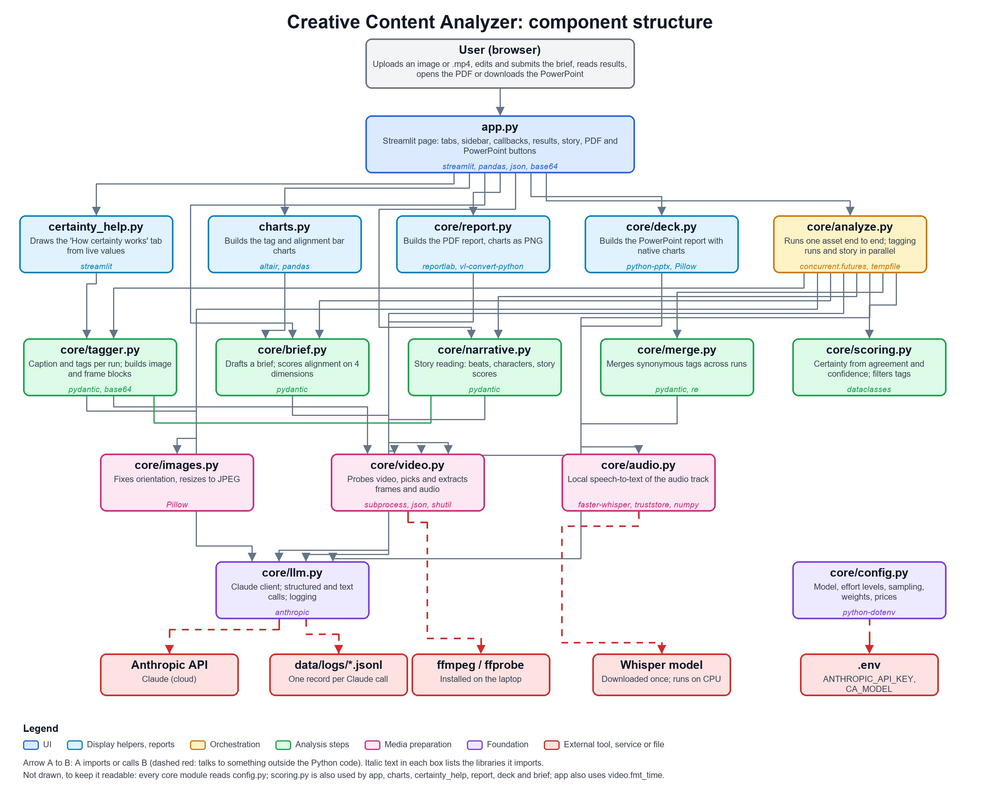

# Creative Content Analyzer: structure

How the app is put together: every component file, every library it uses, and how they combine to produce each output.
The diagram is in [`structure.jpg`](structure.jpg). For design decisions and the build plan, see [`plan.md`](plan.md).

## 1. Component files

### Entry point and display

| File | What it does |
|---|---|
| `app.py` | The Streamlit page, and the only file you run (`streamlit run app.py`). Draws the sidebar (model, K slider, cost estimate), the **Analyze** tab (organization box with Submit button, brief box with Submit button, uploader, output limit, results, story, brief alignment, PDF button) and the **How certainty works** tab. Holds the callbacks (draft brief, submit brief, re-evaluate, create PDF) and keeps the current result in `st.session_state`. Changing Top N or the threshold only re-filters the stored result; it makes no API call. |
| `certainty_help.py` | Content of the **How certainty works** tab. Reads the live weights and rubric from `core/config.py`, `core/scoring.py` and `core/tagger.py`, so the text and worked examples always match the code. |
| `charts.py` | Builds the two Altair bar charts: tag certainty (`tag_chart`) and alignment on a −1…+1 scale (`alignment_chart`, also used for the story scores). Used by both `app.py` and `core/report.py`. |

### Core logic (`core/`)

| File | What it does |
|---|---|
| `core/config.py` | Single place for settings: model ID (`CA_MODEL`), effort levels per call type, score weights (60% agreement, 40% self-confidence), frame-sampling numbers for tagging and the story, token prices, cost estimates, log folder. Loads `.env`. Every other core module reads it. |
| `core/llm.py` | The only file that talks to Claude. Creates the client (90 s timeout, 2 retries), runs structured-output calls (`parse_call`) and plain-text calls (`text_call`), converts refusals and truncated output into `ClaudeCallError`, and appends a record of every call (model, tokens, seconds, output) to `data/logs/<date>.jsonl`. |
| `core/analyze.py` | The orchestrator for one asset (`analyze_asset`). Prepares the image or video, starts the K tagging runs and, for videos, the story reading at the same time, merges tags, scores them, and evaluates brief alignment. Returns one result dictionary that the UI, charts and PDF all read. |
| `core/tagger.py` | One tagging run: asks Claude for a caption and up to 25 tags, each with a source, a 0–100 self-confidence and evidence. Holds the self-confidence rubric. Also builds the image or frame-plus-transcript content blocks that the story and alignment calls reuse. |
| `core/merge.py` | One call that groups synonymous tags across the K runs ("sailboat" / "sailing boat") so they count as one tag. Also normalizes tag text. |
| `core/scoring.py` | Pure functions, no API calls. Turns merged observations into a certainty per tag (`0.6 × agreement + 0.4 × mean self-confidence`) and filters by Top N or threshold. |
| `core/brief.py` | Two jobs: drafts a structured brief from a product description, and scores an asset against a brief on four dimensions (customer, context, product, style; −1…+1) with 3–5 suggestions. Absence scores 0. |
| `core/narrative.py` | Story reading for videos: one call that returns a logline, timestamped beats, characters, arc and gaps, and (with a brief) four story scores (plot, characters, structure, product timing) and suggestions. Refuses to run on still images. |
| `core/images.py` | Fixes EXIF orientation, converts to RGB, shrinks the long edge, returns a JPEG. Used for uploaded images and for video frames. |
| `core/video.py` | Everything that needs ffmpeg: finds the binaries, probes duration and audio, detects scene changes, picks frame times (`pick_timestamps`, used with two parameter sets), extracts frames and audio, formats timestamps. |
| `core/audio.py` | Local speech-to-text. Loads the Whisper model once, reads the 16 kHz WAV and returns timestamped segments. No audio leaves the laptop. |
| `core/deck.py` | Builds the PowerPoint (.pptx) report with python-pptx: a simple white design with native, editable charts, a cover, a contents page with page numbers, and a footer with page numbers, the GitHub URL and the contact email. Sections are included only when they apply (brief, alignment and story pages are skipped when there is no brief or no video), and long text is split over continuation slides. Video story points and characters get thumbnails taken from the frame nearest in time. |
| `core/report.py` | Builds the PDF report with reportlab. Renders the app's own Altair charts to PNG and lays out the sections in the required order, with the footer (GitHub URL and contact email). |
| `core/__init__.py` | Empty; makes `core` a package. |

### Scripts, tests and project files

| File | What it does |
|---|---|
| `scripts/check_api.py` | One-line check that the API key works with the configured model. |
| `scripts/try_image.py` | Runs the image pipeline from the terminal without the UI; `--make-sample` writes the test image. |
| `tests/test_scoring.py` | Scoring, filtering and tag normalization. |
| `tests/test_video.py` | Frame picking, content blocks, and ffmpeg on a generated clip. |
| `tests/test_deck.py` | PowerPoint sections and order, conditional pages, two-chart split, long-brief paging, text-fit helpers. |
| `tests/test_narrative.py` | Story with and without a brief, score clamping, story frame density and cap, refusing images. |
| `tests/test_app.py` | The UI renders (Streamlit `AppTest`), re-filtering, alignment, help tab and video results. |
| `tests/assets/sample_sailboat.png` | Synthetic image used by the tests. |
| `requirements.txt`, `requirements-audio.txt` | Libraries; the second adds optional sound-event libraries (not yet used). |
| `.env` / `.env.example` | `ANTHROPIC_API_KEY` and optional `CA_MODEL`. `.env` is git-ignored. |
| `plan.md`, `README.md`, `structure.md` | Plan and decisions, application overview, this file. |
| `data/logs/` | Git-ignored; one JSONL file per day with a record of every Claude call. |

## 2. Libraries and external tools

| Library / tool | Where it is used | Why |
|---|---|---|
| **streamlit** | `app.py`, `certainty_help.py` | The web UI, widgets, session state, and the iframe that opens the PDF in a new tab. |
| **anthropic** | `core/llm.py`, `scripts/check_api.py` | The Claude API client (structured output, thinking, effort). |
| **pydantic** | `core/tagger.py`, `core/merge.py`, `core/brief.py`, `core/narrative.py` | Schemas that Claude's structured output is validated against. |
| **altair** | `charts.py` | Charts (Vega-Lite). Installed with Streamlit. |
| **pandas** | `app.py`, `charts.py` | Tables and chart data. Installed with Streamlit. |
| **pillow** | `core/images.py`, `core/deck.py` | Image resizing and JPEG encoding; thumbnail sizing in the deck. |
| **reportlab** | `core/report.py` | PDF layout, tables and footer. |
| **python-pptx** | `core/deck.py` | PowerPoint slides, native charts, text and pictures. |
| **vl-convert-python** | `core/report.py` | Renders the Altair charts to PNG for the PDF, with no browser needed. |
| **faster-whisper** | `core/audio.py` | Local speech recognition (CPU, `base` model, downloaded once). |
| **truststore** | `core/audio.py` | Lets Python trust the Windows certificate store, so the model download works on a network that inspects HTTPS. Verification stays on. |
| **numpy** | `core/audio.py` | Converts WAV samples to the array Whisper reads. Installed with faster-whisper. |
| **python-dotenv** | `core/config.py` | Loads `.env`. |
| **pytest** | `tests/` | Test runner. |
| *standard library* | various | `concurrent.futures` (parallel runs), `subprocess` (ffmpeg), `tempfile`, `json`, `base64`, `dataclasses`, `re`, `wave`, `io`, `pathlib`. |
| **ffmpeg / ffprobe** (program) | `core/video.py` | Probing, scene detection, frame and audio extraction. Must be installed. |
| **Anthropic API** (service) | `core/llm.py` | All tagging, merging, alignment, story and brief-drafting calls. |
| *torch, transformers* (optional) | not yet used | Reserved for the planned sound-event module. |

## 3. How the files produce each output

### A. Analyzing an image
1. `app.py`: you press **Analyze**. The previous result is cleared and `analyze_asset` is called with the file bytes, K and the submitted brief.
2. `core/images.py` normalizes the image to a JPEG. `core/tagger.py` wraps it in a content block.
3. `core/analyze.py` starts **K tagging runs in parallel** (`tag_asset`). Each goes through `core/llm.py` to Claude and returns a caption and tags with self-confidence. `llm.py` logs each call.
4. `core/merge.py` sends all the tag strings in one call and gets back a mapping of variants to one canonical tag.
5. `core/scoring.py` computes agreement (share of runs containing the tag), mean self-confidence, and certainty for each tag.
6. If a brief was submitted, `core/brief.py` makes one more call that scores the four alignment dimensions and writes suggestions.
7. The result dictionary goes back to `app.py`, which filters by Top N or threshold (`scoring.filter_tags`), draws charts with `charts.py`, and shows caption, scores, explanations and suggestions.

### B. Analyzing a video
Steps 1–7 above apply, with these differences:
- `core/video.py` probes the file and finds scene changes. `pick_timestamps` is used **twice**: 4–10 frames at 1024 px for tagging and alignment, and about one frame per 0.75 s (cap 60) at 512 px for the story. All needed frames are extracted from the file once, in parallel, then resized by `core/images.py`.
- `core/video.py` extracts the audio and `core/audio.py` transcribes it locally.
- `core/tagger.py` builds one request from the labelled frames and the transcript, so each run tags the video as a whole.
- `core/narrative.py` makes its single call **alongside the tagging runs**, using the story frames and transcript. If it fails, the rest of the analysis still completes.
- `app.py` also shows the video, the frames sent, the transcript, and the **Story** section (timeline, characters, arc, story scores shown separately from the overall alignment).

### C. Drafting and submitting a brief
- **Draft brief** in `app.py` calls `core/brief.draft_brief`, which uses `core/llm.text_call`. The draft is placed in the editable box.
- **Submit brief** copies the box to the submitted brief, which is shown read-only below it. Only the submitted brief is used by Analyze, re-evaluation, the cost estimate and the PDF.
- If the brief changes after an analysis, **Re-evaluate** re-runs alignment (and the story, for videos) from the stored frames, without repeating the tagging.

### D. The PDF report
- **Create PDF report** in `app.py` calls `core/report.build_report` with the stored result, the tags currently shown, the product description and the brief.
- `core/report.py` renders `charts.py`'s charts to PNG with vl-convert and lays out, in order: title, product description, brief used, filename, caption, tag chart, alignment chart, explanations, suggestions, tag table, story (videos), then cost, runs and model, with the footer on every page.
- `app.py` embeds the PDF in a small HTML button; clicking it opens the PDF in a new browser tab from a blob URL, where it can be downloaded.

### E. The PowerPoint report
- **Create PowerPoint report** in `app.py` calls `core/deck.build_deck` with the same inputs as the PDF (stored result, tags currently shown, product description, brief). It makes no API calls.
- `core/deck.py` builds, in order: cover (title, organization name, date), contents (with page numbers), product description, creative brief (one slide, a rounded box per element), asset evaluated (thumbnail, filename, caption), tags detected (native bar chart, split into two charts when there are more than 12 tags), alignment summary (overall score and a native chart of the four dimensions), alignment evaluation and suggestions, story alignment summary (mean and chart of the four story scores), story detected (beats and characters with thumbnails, then arc and limits; videos only), story evaluation and suggestions (videos with a brief), and usage (model, runs, tokens, cost).
- `app.py` then shows a **Download PowerPoint (.pptx)** button. The submitted organization name becomes the cover subtitle and part of the footer in both the PDF and the PowerPoint. Unlike the PDF it can't open in a browser tab, so it downloads.

### F. Costs and logs
Every Claude call passes through `core/llm.py`. It counts tokens, `core/analyze.py` adds them up per asset, and `core/config.cost_usd` converts them to dollars using the price table. The sidebar estimate comes from the `EST_COST_*` values in `config.py`. Each call is also written to `data/logs/`.

### G. What stays on the laptop
Audio, the Whisper model, frame extraction and all scoring arithmetic run locally. Images, video frames, the transcript text and the brief are sent to the Anthropic API.
